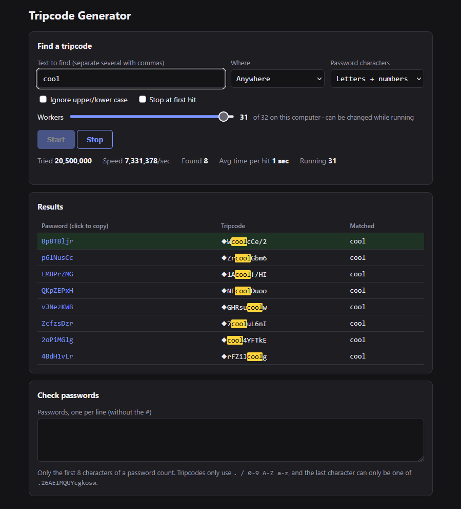

# Tripcode Generator

Tripcode generator and tester. Type the word you want in your trip, hit Start, and it finds passwords that give you that trip. It runs right in your browser and nothing gets sent anywhere.

It generates classic DES-based tripcodes (name#password). Secure trips (name##password) won't match.

Use it here: https://m4c4r0n1n.github.io/Tripcode-Generator/

Or just download index.html and open it.

